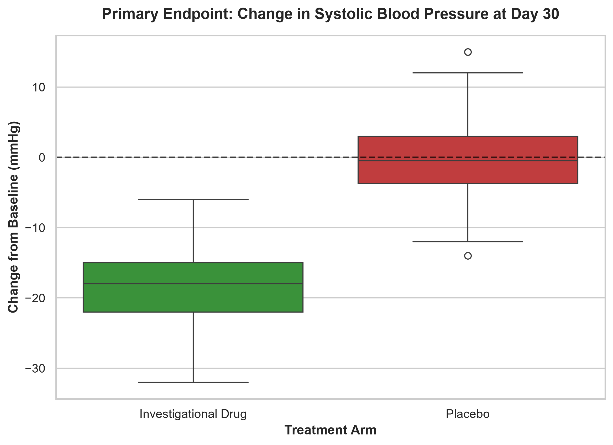

# 🧬 Phase II Clinical Trial Pipeline: CDISC (SDTM/ADaM) & Biostatistics

Welcome to my advanced Clinical Data pipeline project! 

In the clinical research industry, collecting clean data is only half the battle; the ultimate goal is proving to regulatory bodies (like the FDA) that a drug is both safe and effective. I built this project to simulate the entire lifecycle of a randomized, double-blind Phase II clinical trial. 

This repository traces the data journey from the moment a mock patient walks into the clinic for Screening, all the way to the final biostatistical boxplot proving the drug's efficacy.

## 🎯 The Core Objectives
* **Build a realistic clinical foundation:** Generate longitudinal EDC (Electronic Data Capture) data with a mathematically engineered treatment effect.
* **Enforce regulatory standards:** Transform raw, messy hospital data into strict CDISC SDTM formats.
* **Bridge the gap to biostatistics:** Derive ADaM analysis datasets to calculate the exact clinical endpoints.
* **Prove the science:** Run independent statistical testing to confirm the drug actually worked.

## 🛠️ The Tech Stack
* **Core Logic:** Python (Pandas, NumPy, SciPy)
* **Database Backend:** PostgreSQL (SQLAlchemy)
* **Data Visualization:** Matplotlib & Seaborn
* **Clinical Standards:** CDISC SDTM (DM, EX, VS) and ADaM (ADVS)

---

## 🗺️ The Data Journey (Steps Executed)

### Step 1: Simulating the Clinic (Data Generation & Staging)
You cannot analyze a trial without patients. Using `generate_longitudinal_data.py`, I simulated a 200-patient hypertension trial with 1:1 randomization (Investigational Drug vs. Placebo). 
* **The Clinical Setup:** The script builds three chronological visits (Screening, Baseline, End of Study) for every patient. 
* **The Hidden Math:** I mathematically engineered a treatment effect directly into the data—active drug patients experience a gradual drop in blood pressure, while placebo patients remain hypertensive. 
* **The Storage:** All of this was pushed directly into a local **PostgreSQL** database to mimic a live EDC backend.

### Step 2: Meeting FDA Standards (SDTM Mapping)
Raw hospital data is entirely unstandardized. Using `sdtm_mapper.py`, I extracted the SQL tables and mapped them to the **Study Data Tabulation Model (SDTM)**.
* **DM (Demographics):** Standardized dates to ISO 8601 and mapped Planned/Actual treatment arms.
* **EX (Exposure):** Created a drug accountability domain to track exactly when patients swallowed their assigned dose.
* **VS (Vital Signs):** Reshaped wide hospital data into a long format, mapping standardized test codes (`SYSBP`) and ensuring perfect chronological sorting of longitudinal visits.

### Step 3: Preparing for Analysis (ADaM Derivation)
You cannot run statistical analysis on SDTM; it just tells you what happened, not what it means. Using `adam_derivation.py`, I built the **Analysis Data Model (ADaM)**. 
* I constructed the `ADVS` (Basic Data Structure) dataset by isolating Day 1 Baseline blood pressure values, pinning them to post-treatment rows, and calculating the critical **Change from Baseline (`CHG`)** endpoint for every single patient.

### Step 4: The Moment of Truth (Biostatistics)
Did the drug work? Using `stats_analysis.py`, I executed an independent two-sample t-test to evaluate the primary endpoint: *Mean change in Systolic Blood Pressure at Day 30.* I then generated a professional clinical boxplot (`visualize_efficacy.py`) to visually prove the variance and efficacy to regulatory reviewers.

---

## 📈 The Results: Clinical Study Report
The pipeline successfully extracted, transformed, and analyzed the trial data, identifying a massive, statistically significant treatment effect.

* **Investigational Drug (N=102):** Average blood pressure drop of **-18.61 mmHg**.
* **Placebo (N=98):** Average blood pressure drop of just **-0.36 mmHg**.
* **T-Statistic:** -23.47
* **P-Value:** 4.14e-59

**Conclusion:** A highly statistically significant reduction in blood pressure was achieved.

### 📊 Efficacy Visualization
*(This boxplot confirms the T-Test. The green Investigational Drug cohort sits entirely below the zero-change baseline, while the red Placebo cohort hovers directly over it, showing no real clinical effect).*

---

## 🚀 How to Run This Pipeline Locally
1. **Database Setup:** Install PostgreSQL and create an empty database named `phase2_clinical_db`. Run `CREATE SCHEMA clinical_staging;` in the query tool.
2. **Environment:** `pip install pandas numpy scipy matplotlib seaborn sqlalchemy psycopg2-binary`
3. **Execution Order:**
   * Run `src/generate_longitudinal_data.py` to populate the database.
   * Run `src/sdtm_mapper.py` to generate the SDTM domains in the `/data` folder.
   * Run `src/adam_derivation.py` to calculate baselines and generate the ADVS dataset.
   * Run `src/stats_analysis.py` to execute the t-test and print the CSR summary.
   * Run `src/visualize_efficacy.py` to generate the boxplot.